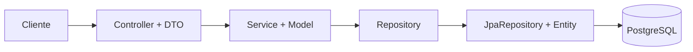
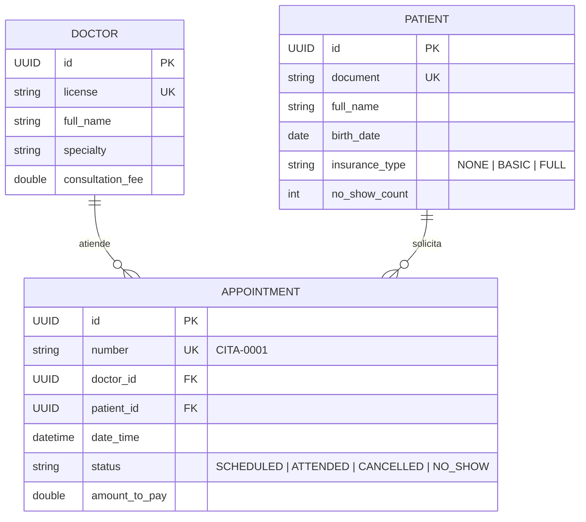

# Clínica: sistema de citas médicas

API REST para agendar citas médicas con reglas de agenda, seguros e inasistencias.

**Tecnología:** Java 21 · Spring Boot 4.1 · Maven · Spring Web MVC · Spring Data JPA · Validation · PostgreSQL · Lombok · Actuator

## Arquitectura

Flujo por capas: el controlador sólo trabaja con DTOs y modelos, el servicio concentra la lógica de negocio y depende de interfaces de repositorio, y las entidades JPA nunca salen de la capa de persistencia.



```
com.example.clinica
├── controllers/            DoctorController, PatientController, AppointmentController
├── dtos/                   <X>CreateDto, <X>UpdateDto, <X>ResponseDto, AppointmentCreateDto, ErrorResponseDto
├── models/                 Doctor, Patient, Appointment (@Data), InsuranceType, AppointmentStatus
├── entities/               DoctorEntity, PatientEntity, AppointmentEntity
├── mappers/                DoctorMapper, PatientMapper, AppointmentMapper (métodos estáticos)
├── repositories/
│   ├── interf/             I<X>Repository (contrato) e I<X>JpaRepository (Spring Data)
│   └── impl/               <X>Repository (adaptador sobre el JPA repository)
├── services/
│   ├── interf/             I<X>Service
│   └── impl/               <X>Service (lógica de negocio)
├── exceptions/             NotFoundException, ConflictException, BusinessRuleException, GlobalExceptionHandler
└── config/                 ClockConfig (reloj inyectable)
```

Todas las dependencias se inyectan **por constructor**. Los métodos que modifican datos llevan `@Transactional`.

## Modelo entidad-relación



Tablas: `doctors`, `patients`, `appointments`. `AppointmentEntity` tiene `@ManyToOne` hacia médico y paciente; `DoctorEntity` y `PatientEntity` tienen el lado inverso `@OneToMany(mappedBy = ...)`. Los enums se guardan como texto (`@Enumerated(EnumType.STRING)`).

## Configuración y ejecución

1. Cree la base de datos:
   ```bash
   psql -U postgres -h localhost -c 'CREATE DATABASE clinica'
   ```
   Las tablas las crea Hibernate al arrancar (`ddl-auto=update`).

2. Las credenciales **no** están en el repositorio: `application.properties` las lee de las variables de entorno `DB_USER` y `DB_PASSWORD`.

   Linux / macOS:
   ```bash
   DB_USER='postgres' DB_PASSWORD='su_clave' ./mvnw spring-boot:run
   ```
   Windows (PowerShell):
   ```powershell
   $env:DB_USER="postgres"; $env:DB_PASSWORD="su_clave"; ./mvnw spring-boot:run
   ```
   Use comillas simples en bash si la clave tiene caracteres como `$` o `!`.

3. Verifique que la aplicación está arriba: `GET http://localhost:8080/actuator/health` → `{"status":"UP"}`.

## Interfaz web

Con la aplicación corriendo, abra **http://localhost:8080/**. Es una página estática (`src/main/resources/static/index.html`) que sólo consume la API con `fetch`; no agrega lógica ni toca las capas del backend.

- **Agenda:** los 18 bloques de 30 minutos (8:00 a 16:30) de un médico en un día. Los bloques libres se agendan con un clic y las citas programadas se pueden atender, cancelar o marcar como inasistencia.
- **Citas:** búsqueda por número e historial de un paciente.
- **Médicos y Pacientes:** listado, creación, edición y eliminación.

Los errores de la API (400, 404, 409, 422) se muestran con su mensaje, así que la interfaz también sirve para demostrar las reglas de negocio. Se puede abrir una sección o fecha directamente: `http://localhost:8080/?date=2026-11-23#agenda`.

## Endpoints

Base: `http://localhost:8080`. Fechas: `yyyy-MM-dd`; fecha y hora: `yyyy-MM-ddTHH:mm:ss`.

### Médicos

| Método | Ruta | Cuerpo | Respuesta |
|---|---|---|---|
| GET | `/api/doctor` | – | 200 lista |
| GET | `/api/doctor/{license}` | – | 200 · 404 |
| POST | `/api/doctor` | `DoctorCreateDto` | 201 · 400 · 409 licencia duplicada |
| PUT | `/api/doctor/{license}` | `DoctorUpdateDto` | 200 · 400 · 404 |
| DELETE | `/api/doctor/{license}` | – | 204 · 404 · 422 si tiene citas `SCHEDULED` |

```json
{ "license": "MED-100", "fullName": "Ana Gómez", "specialty": "Medicina general", "consultationFee": 100000 }
```
`PUT` recibe sólo `fullName`, `specialty` y `consultationFee`.

### Pacientes

| Método | Ruta | Cuerpo | Respuesta |
|---|---|---|---|
| GET | `/api/patient` | – | 200 lista |
| GET | `/api/patient/{document}` | – | 200 · 404 |
| POST | `/api/patient` | `PatientCreateDto` | 201 · 400 · 409 documento duplicado |
| PUT | `/api/patient/{document}` | `PatientUpdateDto` | 200 · 400 · 404 |
| DELETE | `/api/patient/{document}` | – | 204 · 404 · 422 si tiene citas `SCHEDULED` |

```json
{ "document": "1020304050", "fullName": "Carlos Ruiz", "birthDate": "1990-05-10", "insuranceType": "NONE" }
```
`PUT` recibe sólo `fullName`, `birthDate` e `insuranceType`. `noShowCount` empieza en 0 y sólo lo modifica el sistema.

### Citas

| Método | Ruta | Descripción | Respuesta |
|---|---|---|---|
| POST | `/api/appointment` | Agenda (RN1 a RN7) | 201 · 400 · 404 · 409 · 422 |
| GET | `/api/appointment/{number}` | Consulta por número | 200 · 404 |
| PATCH | `/api/appointment/{number}/cancel` | Cancela (RN8) | 200 · 404 · 422 |
| PATCH | `/api/appointment/{number}/attend` | Marca como atendida | 200 · 404 · 422 |
| PATCH | `/api/appointment/{number}/no-show` | Marca inasistencia y suma `noShowCount` | 200 · 404 · 422 |
| GET | `/api/appointment?doctorLicense=&date=` | Citas de un médico en un día | 200 · 400 · 404 |
| GET | `/api/appointment/patient/{document}` | Historial del paciente (más reciente primero) | 200 · 404 |

```json
{ "doctorLicense": "MED-100", "patientDocument": "1020304050", "dateTime": "2026-12-01T09:30:00" }
```

El número (`CITA-0001`, `CITA-0002`, …), el estado inicial (`SCHEDULED`) y `amountToPay` los calcula el servicio; nunca vienen del cliente.

## Reglas de negocio

Todas están en `AppointmentService` (las de eliminación, en `DoctorService` y `PatientService`).

| # | Regla | Error |
|---|---|---|
| RN1 | Citas de 30 min que inician a las `:00` o `:30` | 422 |
| RN2 | Lunes a viernes, de 8:00 a 17:00 (última cita 16:30) | 422 |
| RN3 | No se agenda en el pasado | 422 |
| RN4 | Un médico no tiene dos citas `SCHEDULED` a la misma hora | 409 |
| RN5 | Un paciente no tiene dos citas `SCHEDULED` el mismo día | 409 |
| RN6 | Valor a pagar: `NONE` 100 %, `BASIC` 50 %, `FULL` 0 % de la tarifa | – |
| RN7 | Con 2 o más `NO_SHOW` el paciente no puede agendar | 422 |
| RN8 | Cancelar sólo si la cita está `SCHEDULED` y faltan más de 2 horas | 422 |

Máquina de estados: `SCHEDULED → ATTENDED | CANCELLED | NO_SHOW`. Los tres son finales; cualquier otro cambio responde 422.

Orden de validación al agendar: médico y paciente existen (404) → RN1 → RN2 → RN3 → RN7 → RN4 → RN5.

## Errores

`GlobalExceptionHandler` devuelve siempre el mismo formato:

```json
{ "timestamp": "2026-11-12T10:00:00", "status": 409, "error": "Conflict",
  "message": "El médico MED-100 ya tiene una cita en ese horario", "path": "/api/appointment" }
```

| Código | Cuándo |
|---|---|
| 400 | Datos faltantes o inválidos (`@Valid`), JSON mal formado, seguro desconocido, parámetro faltante o con formato incorrecto |
| 404 | Médico, paciente o cita inexistente |
| 409 | Licencia o documento duplicado, RN4, RN5 |
| 422 | RN1, RN2, RN3, RN7, RN8, cambio de estado inválido, eliminar con citas `SCHEDULED` |

## Pruebas

```bash
./mvnw test
```

Las pruebas usan una base **H2 en memoria** (`src/test/resources/application.properties`), así que no necesitan PostgreSQL ni variables de entorno. El reloj se fija en el lunes 16/11/2026 a las 7:00 para que RN3 y RN8 den siempre el mismo resultado.

| Clase | Tipo | Qué cubre |
|---|---|---|
| `ClinicaApiIntegrationTest` | Integración (todas las capas + H2) | Los 13 casos de la sección 5, estados, consultas, CRUD, duplicados, validaciones y formato de error |
| `AppointmentServiceTest` | Unitaria (Mockito) | RN1 a RN8, máquina de estados, consecutivo del número |
| `DoctorServiceTest`, `PatientServiceTest` | Unitaria (Mockito) | Duplicados, eliminación con citas, `noShowCount` inicial |
| `ClinicaApplicationTests` | Contexto | Arranque y `/actuator/health` = `UP` |

Resultado: **47 pruebas, 0 fallos**.

## Postman

Importe `docs/clinica.postman_collection.json` y ejecútela completa con **Run collection**, en el orden en que viene.

- La primera petición prepara los datos: genera un sufijo para esta ejecución (`MED-100-K3F9`, `P-1-K3F9`, …) y calcula las fechas (el próximo lunes, el sábado, ayer). Así la colección se puede ejecutar varias veces sin chocar con datos anteriores.
- Cada petición verifica su código HTTP y, cuando aplica, el `amountToPay`, el estado o el `noShowCount`.
- **RN8 (cancelar con menos de 2 h)** necesita una cita que empiece pronto, así que sólo se puede probar de lunes a viernes entre 7:30 y 16:30. Fuera de ese horario esas dos peticiones se omiten (aparecen como *skipped*); la regla igual queda cubierta por las pruebas automáticas.
